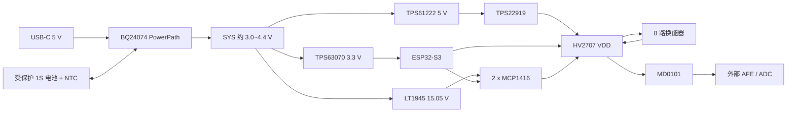

# WULPUS 风格 ESP32-S3 两层超声收发实验板参考设计

本目录是一套可据此在 Altium Designer 或 KiCad 中绘制原理图和 PCB 的工程规格，不是已经通过 DRC、EMC、安规或医疗认证的制造文件。

## 设计目标

- USB-C 5 V 输入，USB 2.0 直连 ESP32-S3，用于下载、日志和控制通信。
- BQ24074 单节锂电池充电与 PowerPath，支持边充电边运行；默认 USB 输入限流 500 mA。
- 受保护的 1S Li-ion/LiPo 电池，3 线接口：BAT+、10 kΩ NTC、GND。
- TPS63070 生成稳定 3.3 V，给 ESP32-S3 和数字逻辑供电。
- TPS61222 + TPS22919 生成并受控接通 5 V，满足 HV2707 的 VLL/VDD 上电顺序。
- LT1945 正升压通道生成 15.05 V，给两个 MCP1416 脉冲驱动器供电。
- 一个 HV2707 以“每通道一只 TX 开关 + 一只 RX 开关”的方式形成 8 通道收发复用。
- MD0101 保护公共接收端，RX_OUT 接外部 LNA/PGA/ADC，不接 ESP32 ADC 采集原始 MHz 回波。
- 发射工作方式为单通道、0~15 V 单极性短 burst；不把本链路当作连续波功放，也不允许多通道同时发射。

## 目录

- `SCHEMATIC_SPEC_CN.md`：逐页、逐引脚原理图连接规格和计算值。
- `PIN_NETLIST.csv`：可导入表格核对的关键 IC 引脚/网络表。
- `BOM.csv`：推荐料号、封装、参数和装配备注。
- `GPIO_MUX_MAP.csv`：ESP32 GPIO、HV2707 开关位和收发时序。
- `PCB_LAYOUT_RULES_CN.md`：两层板分区、地回流、线宽、间距和检查清单。
- `DATASHEET_INDEX.csv`：每份官方资料的必看页及本设计使用的参数。
- `datasheets/official/`：下载的官方数据手册和连接器图纸。
- `wulpus_original_reference/`：原 WULPUS HV 板原理图 PDF 与原 BOM，仅作拓扑对照。
- `../output/pdf/WULPUS_ESP32S3_2Layer_Reference_Design_CN.pdf`：上述内容的打印版总文档。

## 三个不能省略的边界

1. BQ24074 不是电芯保护器。必须使用带过充、过放和过流保护的 1S 电池包；不能把裸电芯直接当成“已保护电池”。
2. MCP1416 是推挽驱动器，发射结束后仍呈低阻态。要接收回波，不能把它直接永久接在换能器上；必须保留 HV2707 的 TX/RX 成对隔离及 break-before-make 时序。
3. 本版约 15 V，主要风险是尖峰、短路、热和 EMI，并非 40~100 V 超声脉冲板。若目标幅值高于 18 V，MCP1416 和本电源链均需重新选型，不能只改 LT1945 反馈电阻。

## 换能器参数必须在布板前补齐

至少记录中心频率、静态电容、等效串联电阻、允许峰值电压、线缆长度/阻抗和期望 burst/PRF。对近似电容负载，每个完整充放电周期由驱动器消耗的能量约为 `CLOAD × VDRV²`，burst 内动态功率约为 `CLOAD × VDRV² × f`。例如 1 nF、15 V、2 MHz 时 burst 内约 0.45 W；10 nF 时约 4.5 W，不能按同一组驱动/散热处理。首板从总发射占空比不高于 1% 开始，最终限值以 V15 掉压、MCP1416/HV2707 温升和换能器厂家额定为准。
